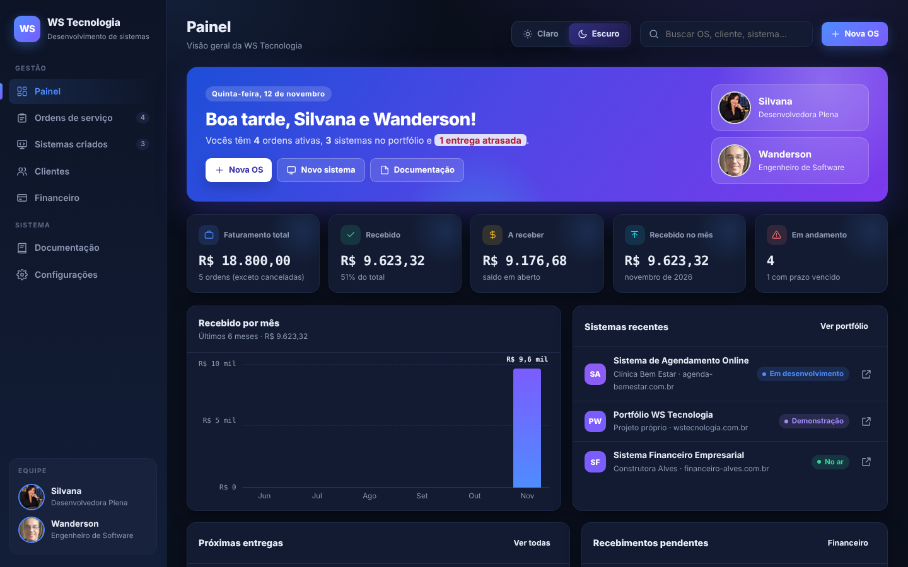
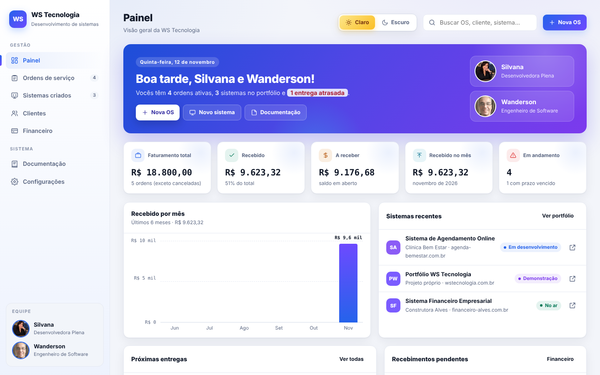
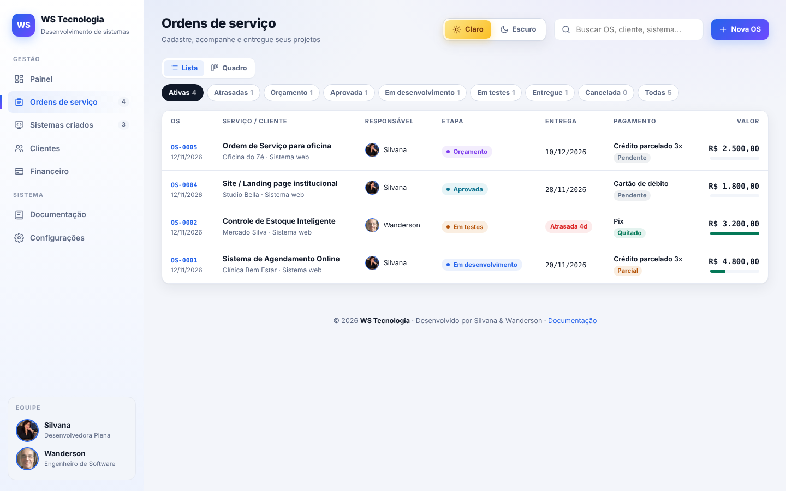
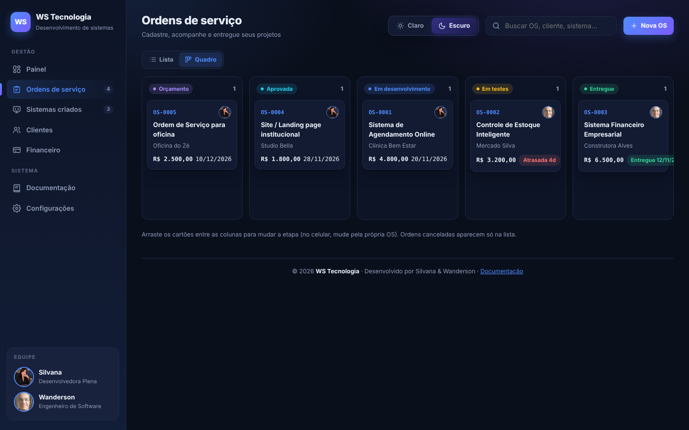
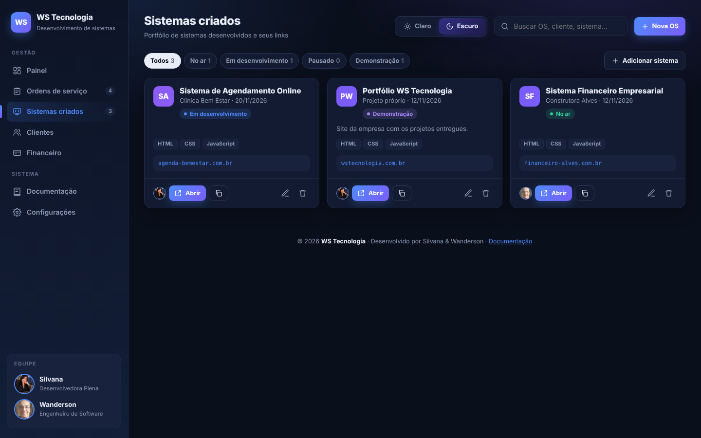
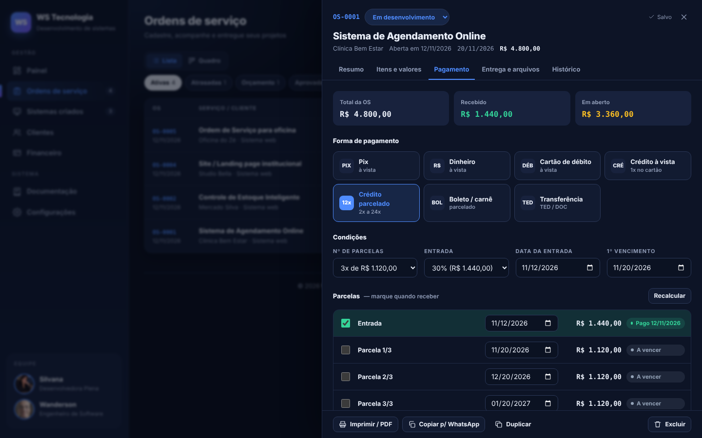
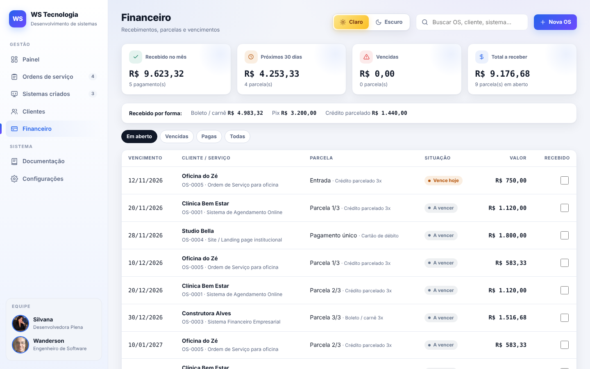
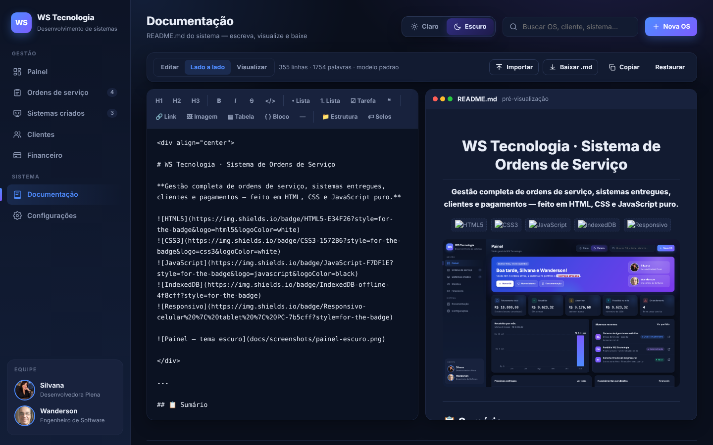
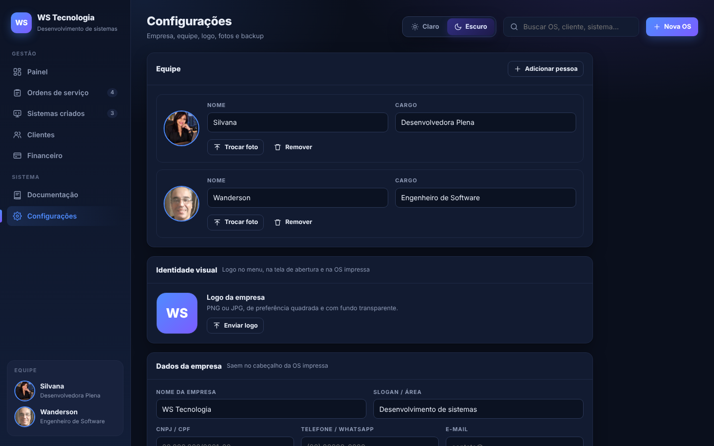
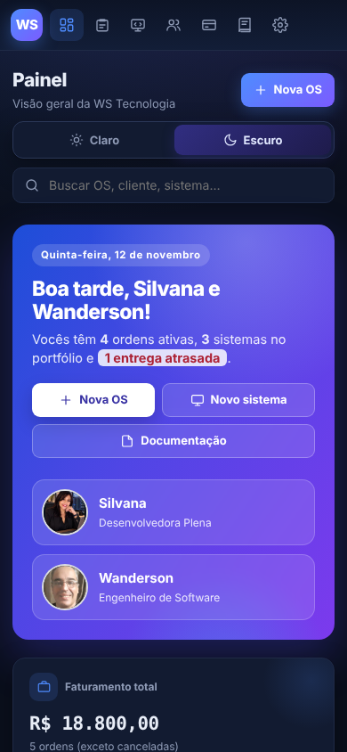

<div align="center">

# WS Tecnologia · Sistema de Ordens de Serviço

**Gestão completa de ordens de serviço, sistemas entregues, clientes e pagamentos — feito em HTML, CSS e JavaScript puro.**




</div>

---

## 📋 Sumário

- [Sobre o projeto](#-sobre-o-projeto)
- [Equipe](#-equipe)
- [Funcionalidades](#-funcionalidades)
- [Capturas de tela](#-capturas-de-tela)
- [Estrutura de pastas](#-estrutura-de-pastas)
- [Arquitetura do código](#-arquitetura-do-código)
- [Como usar](#-como-usar)
- [Onde os dados ficam salvos](#-onde-os-dados-ficam-salvos)
- [Fluxo de uma ordem de serviço](#-fluxo-de-uma-ordem-de-serviço)
- [Formas de pagamento](#-formas-de-pagamento)
- [Personalização](#-personalização)
- [Publicar na internet](#-publicar-na-internet)
- [Tecnologias](#-tecnologias)
- [Próximas melhorias](#-próximas-melhorias)
- [Licença](#-licença)

---

## 💡 Sobre o projeto

Sistema web criado pela **WS Tecnologia** para controlar o dia a dia de uma empresa de desenvolvimento de sistemas:

- cadastrar **ordens de serviço (OS)** com cliente, escopo, itens, prazo e responsável;
- acompanhar cada OS por **etapas** (do orçamento até a entrega);
- controlar **pagamentos** à vista e **parcelados**, com entrada e vencimentos;
- manter um **portfólio dos sistemas criados**, com o link de cada um;
- **imprimir / gerar PDF** da OS e enviar um **resumo pelo WhatsApp**.

Não precisa de servidor, banco de dados externo nem instalação: basta abrir o `index.html` no navegador. Funciona **offline**.

---

## 👥 Equipe

<table>
  <tr>
    <td align="center" width="200">
      <br>
      <b>Silvana</b><br>
      <sub>Desenvolvedora Plena</sub>
    </td>
    <td align="center" width="200">
      <br>
      <b>Wanderson</b><br>
      <sub>Engenheiro de Software</sub>
    </td>
  </tr>
</table>

> A equipe é editável em **Configurações → Equipe** (nome, cargo e foto). É possível adicionar mais pessoas.

---

## ✨ Funcionalidades

### 📊 Painel
- Saudação com as fotos da equipe e resumo do dia
- Indicadores: **faturamento total, recebido, a receber, recebido no mês e ordens em andamento/atrasadas**
- Lista das **próximas entregas** e dos **recebimentos pendentes**
- Gráfico de **ordens por etapa** (clicável)

### 🧾 Ordens de serviço
- Numeração automática (`OS-0001`, `OS-0002`…)
- Visualização em **Lista** (com filtros) ou **Quadro** (arrastar e soltar entre etapas)
- Busca por número, serviço, cliente ou descrição
- Cada OS tem 5 abas:

| Aba | O que tem |
|---|---|
| **Resumo** | Serviço, tipo, responsável, prioridade, abertura, prazo, garantia, escopo e dados do cliente (CPF/CNPJ, WhatsApp, e-mail) |
| **Itens e valores** | Itens do orçamento (descrição, quantidade, valor), desconto e total |
| **Pagamento** | Forma de pagamento, entrada, nº de parcelas, vencimentos e marcação de "recebido" |
| **Entrega e arquivos** | Link do sistema pronto, ambiente de testes, repositório, arquivos anexados (.zip, .pdf, imagens…) e observações para o cliente |
| **Histórico** | Linha do tempo automática (mudança de etapa, pagamentos, anexos) + anotações manuais |

- Ações: **Imprimir / PDF**, **Copiar para WhatsApp**, **Duplicar**, **Excluir**

### 🖥️ Sistemas criados
- Portfólio dos sistemas desenvolvidos, em cartões
- Nome, cliente, situação (**No ar, Em desenvolvimento, Pausado, Demonstração**), tecnologias, descrição e responsável
- Botões **Abrir sistema**, **Copiar link** e **Código-fonte**
- Sugestão automática: OS que já têm link aparecem para entrar no portfólio com 1 clique

### 👤 Clientes
- Lista gerada automaticamente a partir das OS
- Contato, quantidade de ordens, total faturado e valor a receber por cliente

### 💰 Financeiro
- Recebido no mês, a receber nos próximos 30 dias, parcelas vencidas e total em aberto
- **Recebido por forma de pagamento** (Pix, cartão, boleto…)
- Tabela de todas as parcelas com filtros (em aberto, vencidas, pagas) e marcação rápida de recebimento

### 📖 Documentação (README.md)
- Campo para **escrever ou colar o README.md** do sistema, com **visualização ao vivo**
- Três modos: **Editar**, **Lado a lado** e **Visualizar** (com sumário automático)
- Barra de formatação: títulos, negrito, listas, tarefas, links, imagens, tabelas, blocos de código
- Botões prontos para inserir a **estrutura de pastas** e os **selos das tecnologias**
- **Importar** um `.md`, **baixar** o `README.md` e copiar o texto
- Salva sozinho e vai junto no backup

### ⚙️ Configurações
- **Identidade visual**: logo da empresa (aparece no menu, na abertura e na OS impressa)
- **Equipe**: nome, cargo e foto de cada integrante
- **Dados da empresa**: nome, slogan, CNPJ/CPF, telefone, e-mail, site, cidade, chave Pix e termos padrão (saem na OS impressa)
- **Backup**: exportar, restaurar e importar do sistema antigo

### 🎨 Interface
- Tela de abertura com a marca, painel com destaque em degradê e animações suaves
- Gráfico de **recebido por mês** (últimos 6 meses) e lista de **sistemas recentes**
- Tema **claro** e **escuro** (fica salvo)
- **100% responsivo**: no celular o menu vira barra superior e as tabelas viram cartões
- Atalho `Esc` para fechar janelas

---

## 📸 Capturas de tela

| Painel (claro) | Ordens em lista |
|---|---|
|  |  |

| Quadro (arrastar entre etapas) | Sistemas criados |
|---|---|
|  |  |

| Pagamento da OS | Financeiro |
|---|---|
|  |  |

| Documentação (README.md) | Configurações |
|---|---|
|  |  |

<p align="center"><b>No celular</b><br></p>

---

## 📁 Estrutura de pastas

```text
ws-tecnologia-os/
│
├── index.html              # Página principal (estrutura, menus e janelas)
│
├── css/
│   └── style.css           # Todo o visual: cores, temas claro/escuro, layout e responsivo
│
├── js/
│   ├── tema.js             # Aplica o tema salvo antes da página aparecer
│   ├── config.js           # Constantes: etapas, prioridades, formas de pagamento, equipe padrão
│   ├── utils.js            # Utilidades (moeda, datas, ícones) e regras de negócio (totais, parcelas)
│   ├── db.js               # Banco de dados no navegador (IndexedDB)
│   ├── views.js            # Telas: Painel, Ordens, Sistemas, Clientes, Financeiro, Configurações
│   ├── ordem.js            # Detalhe da OS: abas, edição, pagamento, arquivos, impressão e WhatsApp
│   ├── readme-padrao.js    # README inicial que aparece na tela Documentação
│   ├── docs.js             # Tela Documentação: editor Markdown + visualização
│   └── app.js              # Inicialização, navegação, tema, logo, modais e backup
│
├── img/
│   ├── silvana.jpg         # Foto da Silvana
│   └── engenheiro.jpg      # Foto do Wanderson
│
├── docs/
│   └── screenshots/        # Imagens usadas neste README
│
└── README.md               # Este arquivo
```

> ⚠️ Os scripts são carregados **nesta ordem** no `index.html`: `config.js → utils.js → db.js → views.js → ordem.js → readme-padrao.js → docs.js → app.js`. Não altere a ordem.

---

## 🧩 Arquitetura do código

```text
            ┌─────────────┐
            │ index.html  │  estrutura + modais
            └──────┬──────┘
                   │ carrega
   ┌───────────────┼──────────────────────────────┐
   │               │                              │
┌──▼───────┐  ┌────▼─────┐  ┌──────────┐  ┌──────▼─────┐
│config.js │→ │ utils.js │→ │  db.js   │→ │  views.js  │→ ordem.js → docs.js → app.js
│constantes│  │ regras   │  │IndexedDB │  │   telas    │   detalhe    início
└──────────┘  └──────────┘  └──────────┘  └────────────┘
```

**Modelo de dados de uma OS** (salvo no IndexedDB):

```js
{
  id: "lq3k9x...",            // identificador único
  numero: 1,                  // exibido como OS-0001
  titulo: "Sistema de Agendamento Online",
  tipo: "Sistema web",
  responsavel: "silvana",     // id do integrante da equipe
  prioridade: "media",        // baixa | media | alta | urgente
  status: "desenvolvimento",  // orcamento | aprovada | desenvolvimento | testes | entregue | cancelada
  abertura: "2026-11-12", prazo: "2026-11-20", entregueEm: "",
  cliente: { nome, doc, tel, email },
  descricao: "Escopo do projeto…",
  itens: [ { id, desc, qtd, valor } ],
  desconto: 0,
  pg: { forma: "parcelado", qtd: 3, entrada: 30, venc: "2026-11-20" },
  parcelas: [ { id, desc, valor, venc, pago, pagoEm } ],
  links: { producao, homolog, repo },
  arquivos: [ { id, name, size, type } ],  // o conteúdo fica no store "arquivos"
  garantia: 90, obsCliente: "",
  historico: [ { t, txt, nota } ]
}
```

**Stores do IndexedDB** (banco `ws-tecnologia-os`): `ordens`, `sistemas`, `arquivos` e `config` (dados da empresa e o texto do README).

**Markdown suportado na tela Documentação:** títulos, negrito, itálico, riscado, código, blocos de código, citações, listas (inclusive aninhadas e de tarefas), tabelas com alinhamento, links, imagens, linhas divisórias e HTML simples (`<div align="center">`, `<table>`, ``, `<sub>`…). Scripts e códigos perigosos são removidos automaticamente.

---

## 🚀 Como usar

1. Baixe ou clone esta pasta.
2. Abra o arquivo **`index.html`** com dois cliques (Chrome, Edge ou Firefox).
3. Vá em **Configurações** e preencha os dados da empresa (CNPJ, telefone, chave Pix).
4. Clique em **+ Nova OS** e cadastre o primeiro serviço.

> Dica: para usar no celular, publique a pasta na internet (veja abaixo) e abra o link no navegador do celular.

---

## 💾 Onde os dados ficam salvos

Os dados ficam **no navegador** (IndexedDB), no computador onde o sistema foi aberto. Nada é enviado para servidores.

| Situação | O que acontece |
|---|---|
| Fechar e abrir de novo | ✅ Os dados continuam lá |
| Abrir em outro navegador ou computador | ❌ Começa vazio — use o backup |
| Limpar os dados do navegador | ❌ Os dados são apagados — use o backup |

**Backup** (em Configurações):
- **Exportar backup** → baixa um `.json` com ordens, sistemas, equipe, fotos, logo, README e arquivos anexados.
- **Restaurar backup** → substitui os dados atuais pelos do arquivo.
- **Importar do sistema antigo** → traz as ordens (e arquivos) do sistema anterior, sem apagar as atuais.

---

## 🔄 Fluxo de uma ordem de serviço

```text
Orçamento → Aprovada → Em desenvolvimento → Em testes → Entregue
                                                    ↘ Cancelada
```

Cada mudança de etapa fica registrada no **Histórico** da OS. Ao marcar como **Entregue**, a data de entrega é salva automaticamente.

---

## 💳 Formas de pagamento

| Forma | Tipo | Parcelas |
|---|---|---|
| Pix | à vista | 1 |
| Dinheiro | à vista | 1 |
| Cartão de débito | à vista | 1 |
| Crédito à vista | à vista | 1 |
| **Crédito parcelado** | parcelado | 2x a 24x |
| **Boleto / carnê** | parcelado | 2x a 24x |
| Transferência (TED/DOC) | à vista | 1 |

- Qualquer forma aceita **entrada** (10% a 70%).
- As parcelas são calculadas automaticamente; os centavos que sobram vão para a última parcela.
- Os vencimentos podem ser editados um a um.

---

## 🎨 Personalização

As cores ficam no início do `css/style.css`, em variáveis:

```css
:root, [data-theme=dark] {
  --brand:  #4f8cff;   /* cor principal (azul)  */
  --brand2: #7b5cff;   /* cor do degradê (roxo) */
  --bg:     #0a0f1c;   /* fundo do tema escuro  */
}
[data-theme=light] {
  --brand: #2563eb;
  --bg:    #f3f5fa;    /* fundo do tema claro   */
}
```

Outros ajustes rápidos em `js/config.js`:
- `TIPOS` → tipos de serviço
- `FORMAS` → formas de pagamento
- `STATUS` → etapas da OS
- `EQUIPE_PADRAO` → equipe inicial

---

## 🌐 Publicar na internet

Como é um site estático (só HTML, CSS e JS), pode ser publicado de graça em:

- **GitHub Pages** → suba a pasta num repositório e ative *Settings → Pages*
- **Netlify** ou **Vercel** → arraste a pasta para o painel

> Cada pessoa que abrir o link terá os próprios dados no próprio navegador.

---

## 🛠️ Tecnologias

- **HTML5** — estrutura semântica
- **CSS3** — variáveis, Grid, Flexbox, media queries, temas claro/escuro
- **JavaScript (ES2020+)** — sem frameworks e sem dependências
- **IndexedDB** — banco de dados do navegador (inclusive arquivos)
- **Google Fonts** — Manrope e JetBrains Mono (opcional; sem internet usa a fonte do sistema)

---

## 🗺️ Próximas melhorias

- [ ] Login com usuário e senha
- [ ] Banco de dados online para sincronizar entre computadores
- [ ] Gráfico de faturamento por mês
- [ ] Envio da OS por e-mail
- [ ] Cadastro de clientes independente das OS

---

## 📄 Licença

© 2026 **WS Tecnologia** — todos os direitos reservados.
Desenvolvido por **Silvana** (Desenvolvedora Plena) e **Wanderson** (Engenheiro de Software).
